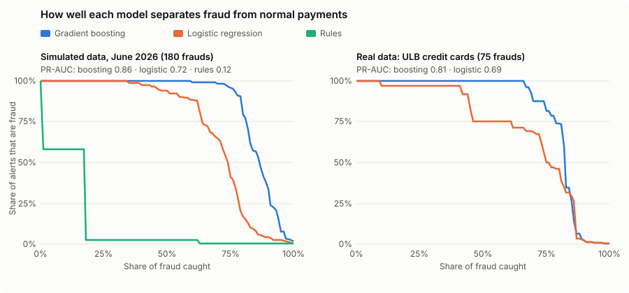
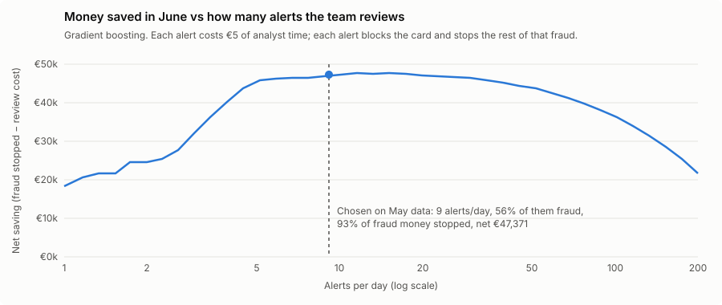

# 💳 Card Fraud Detection

**Catch card fraud early, explain every alert, and tune the alert volume to save the most money. A live fraud-analyst app, tested on simulated and real card data.**

[](https://sh-card-fraud-detection.streamlit.app/)
[](https://www.python.org/)
[](https://scikit-learn.org/)
[](https://github.com/saeedm31/card-fraud-detection/actions/workflows/tests.yml)
[](LICENSE)

👉 **[Open the live app](https://sh-card-fraud-detection.streamlit.app/)**

---

## 💡 The problem

Fewer than 1 in 200 card payments is fraud, so accuracy means nothing: a model that approves everything is 99.6% accurate. What a fraud team actually needs:

- **Rank** fraud above normal payments, so the few alerts analysts can review are the right ones.
- **Act fast**: when an alert fires, the card is blocked and the rest of that fraud is stopped.
- **Explain** each alert in plain words, so an analyst can decide in seconds.
- **Choose the alert volume** that saves the most money, not the one with the best metric.

## ✨ What the app does

- **🚨 Alert queue**: June's alerts, riskiest first, each with its reasons ("€420, 26× this customer's usual", "5 payments in the last hour, all under €5"), the customer's recent payments and what happened next.
- **🔍 Check a payment**: make up a payment for a customer (amount, shop, city, device, time) and see the risk and the reasons change live. Try the card-testing and account-takeover examples.
- **💶 Threshold & money**: slide the number of alerts per day and see fraud stopped, review cost and net saving.
- **📊 Models** and **🌍 Real data**: rules vs logistic regression vs gradient boosting, on simulated and real card data.

## 📈 Results

**Simulated data.** Trained on January to April, alert threshold chosen on May, tested on June: 56,416 payments, 180 of them fraud in 51 cases (€52,657).

| Model | PR-AUC | Alerts per day | Alerts that are fraud | Fraud caught | Fraud money stopped | Net saving in June |
|---|---|---|---|---|---|---|
| Rules (5 classic checks) | 0.12 | 141 | 3% | 63% | 97% | €30,233 |
| Logistic regression | 0.72 | 17 | 27% | 78% | 86% | €42,732 |
| **Gradient boosting** | **0.86** | **9** | **56%** | **86%** | **93%** | **€47,371** |

Net saving = fraud stopped minus €5 of analyst time per alert. The rules stop a lot of money only by flagging 141 payments a day, 97% of them false alarms.

**Real data.** The same models on the [ULB credit card dataset](https://www.kaggle.com/datasets/mlg-ulb/creditcardfraud): 284,807 real payments by European cardholders, 492 frauds, split by time. Test window: 56,962 payments, 75 frauds.

| Model | PR-AUC | Alerts | Alerts that are fraud | Fraud caught | Fraud money stopped |
|---|---|---|---|---|---|
| Logistic regression | 0.69 | 95 | 58% | 73% | 61% |
| **Gradient boosting** | **0.81** | **74** | **78%** | **77%** | **69%** |

Gradient boosting beats logistic regression by a similar margin on both, a sign that the simulation is not unrealistically easy.





**Which fraud gets caught** (gradient boosting, June): card testing 100%, account takeover 94%, stolen card 76%, subtle fraud 29%. Subtle fraud (ordinary-looking online purchases, half of them from the customer's own device) is hard on purpose: no model should catch everything.

## 🧠 How it works

```
Simulator ─ 3,000 customers, 6 months, 343,039 payments, 330 fraud cases
    │         normal life includes trips, big purchases, new phones, shared tablets, in-app bursts
    ▼
Behavioural features (only what was known at payment time)
    │   amount vs this customer's usual · distance from home · impossible travel
    │   new shop · new device · device seen on other cards · payments in the last hour / day
    ▼
Models ─ rules · logistic regression · gradient boosting
    │
    ▼
Time split ─ train Jan-Apr · pick the threshold on May (max net saving) · report June
    │
    ▼
Reasons ─ re-score with each signal set to normal; the biggest drops explain the alert
    │
    ▼
Streamlit app ─ alert queue · check a payment · threshold & money · models · real data
```

**Design choices worth noting**
- **Features compare each payment with the customer's own past.** €400 is normal for one customer and 26× usual for another.
- **No leakage, tested.** A unit test changes every payment after a given moment and checks that no earlier feature moves.
- **Evaluated in money, not accuracy.** An alert blocks the card, so catching the first payment of a fraud stops the whole case. The threshold is chosen on May to maximise net saving, then checked on June.
- **Reasons without extra libraries.** Each group of signals (amount, location, device, burst of payments...) is reset to normal and the payment scored again. Only signals that are actually unusual are shown.
- **Fraud comes in realistic cases**: card testing (tiny online payments, then big ones), stolen card (in-store, often in another city), account takeover (big online purchases from a new device, often at night) and subtle fraud.

## 🚀 Run it

```bash
git clone https://github.com/saeedm31/card-fraud-detection.git
cd card-fraud-detection
pip install -r requirements.txt

streamlit run app.py          # the app (builds the data and model on first load, about 30 s)
python train.py               # compare the three models, writes reports/metrics.json
python plot_results.py        # redraw the charts in docs/
```

**Real-data benchmark:** download `creditcard.csv` from [Kaggle](https://www.kaggle.com/datasets/mlg-ulb/creditcardfraud) or [OpenML](https://www.openml.org/d/1597) (it's 150 MB, so not in this repo), then:

```bash
python benchmark_ulb.py creditcard.csv      # writes reports/benchmark_ulb.json
```

## 📁 Project structure

```
├── app.py                     # Streamlit app
├── train.py                   # compare models on simulated data → reports/metrics.json
├── benchmark_ulb.py           # same evaluation on the real ULB data → reports/benchmark_ulb.json
├── plot_results.py            # README charts
├── fraud_detection/
│   ├── simulate.py            # customers, shops, devices, normal life and fraud cases
│   ├── features.py            # behavioural features, no look-ahead
│   ├── models.py              # rules, logistic regression, gradient boosting, time split
│   ├── evaluate.py            # PR-AUC, alert budget, money stopped, best threshold
│   ├── explain.py             # plain-language reasons for each alert
│   └── service.py             # what the app calls
├── reports/                   # saved results
└── tests/                     # unit tests + a headless run of the app
```

## ✅ Tests

```bash
python -m unittest
```

They run on every push (GitHub Actions) and cover:
- the simulator: same seed, same data; fraud rate; every fraud belongs to a case
- **no look-ahead** in the features, velocity counts, impossible travel
- money: blocking a card stops the rest of the case; review costs are counted
- the time split, model ranking, the threshold choice
- reasons only use signals that are actually unusual
- the real-data benchmark (on a small file with the same columns)
- the app itself, run headless with Streamlit's test tool

## ⚠️ Limitations

- The main data is simulated. It is built to be realistic (normal life looks suspicious too, and fraudsters adapt), but real fraud is messier. The real-data benchmark is the check.
- Fraud labels arrive instantly here. In practice they come days or weeks later (chargebacks), which delays retraining.
- Reasons explain one model's behaviour, not the true cause, and signals that work together share the credit.

---

Built by [Saeed Hojjatpanah](https://github.com/saeedm31). Real data: ULB Machine Learning Group, [Credit Card Fraud Detection](https://www.kaggle.com/datasets/mlg-ulb/creditcardfraud) (Database Contents License).
