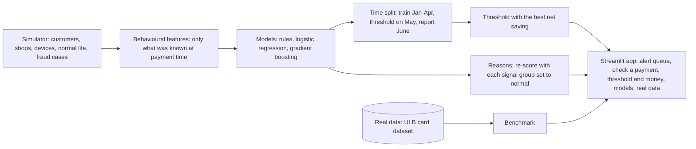

# Architecture

## The parts

| Part | Code | What it does |
|---|---|---|
| Simulator | `fraud_detection/simulate.py` | 3,000 customers over 6 months: normal life (trips, big purchases, new phones, shared tablets, in-app bursts) and four kinds of fraud cases |
| Features | `fraud_detection/features.py` | 17 features that compare each payment with the customer's own past; a unit test proves no feature uses later data |
| Models | `fraud_detection/models.py` | 5 classic rules, logistic regression and gradient boosting, all with the same time split |
| Evaluation | `fraud_detection/evaluate.py` | PR-AUC, alerts per day, fraud caught, money stopped, net saving after EUR 5 of analyst time per alert |
| Reasons | `fraud_detection/explain.py` | for each signal group, score the payment again with that group set to normal; the biggest drops are the reasons |
| Service | `fraud_detection/service.py` | what the app calls: build data, train, score, explain |
| App | `app.py` | alert queue, check a payment, threshold and money, model comparison, real-data results |
| Real-data benchmark | `benchmark_ulb.py` | the same evaluation on 284,807 real payments, split by time |

## How money is counted

An alert blocks the card, so catching the first payment of a fraud case stops the rest of that case. Net saving =
fraud money stopped minus EUR 5 per alert. The alert threshold is chosen on May to maximise net saving, then
checked on June, so the reported number is not tuned on the data it is measured on.

## Where it runs

| Piece | Local | Public demo | GitHub Actions |
|---|---|---|---|
| App | `streamlit run app.py` (builds data and model on first load, about 30 s) | Streamlit Cloud | headless app test |
| Training and report | `python train.py` writes `reports/metrics.json` | - | unit tests on every push |
| Real-data benchmark | `python benchmark_ulb.py creditcard.csv` (file not in the repo) | results in `reports/benchmark_ulb.json` | test on a small file with the same columns |

## Path to production

Score each payment at authorisation from a feature store holding each customer's recent history; send alerts
above the chosen threshold to the fraud team's case tool with the reasons; retrain monthly once chargeback labels
arrive (they come days or weeks later); watch alerts per day, precision and net saving per week.

More: [model card](model_card.md) · [data card](data_card.md)
